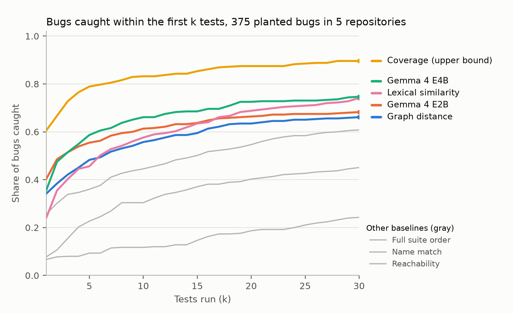

# Which tests should run first?

After a code change, a small Gemma 4 model running on a laptop reads the code graph and orders the tests so the one that catches a bug runs early.

The code graph alone misses tests that reach the changed code through inheritance, decorators or Python syntax (`in` calls `__contains__`, a `for` loop calls `__iter__`). A small local model can read the code and suggest those tests, but it costs seconds per change, so we also measure the suite runtime at which it pays off.

**Result.** On 375 planted one-operator bugs in five Python repositories, ordering tests by code-graph distance puts a failing test in the first 10 for 56% of bugs; Gemma 4 E4B re-ranking raises that to 66% (+10.4 points, 95% interval +6.7 to +14.1) and E2B to 61%. On 76 real regressions replayed from the competition's FastAPI and Rich tasks every method does far worse: the pre-registered prompt adds nothing on FastAPI, E4B gains 19 points on held-out Rich, and a second prompt designed on FastAPI did not pass its pre-registered held-out test. Lexical similarity is a strong cheap baseline. Started in parallel with the graph-distance order, the model never slows the loop. "Coverage" is an upper bound: it needs a recorded run of every test.



**Paper:** [paper/paper.md](paper/paper.md) · **Kaggle notebook:** [which-tests-should-run-first](https://www.kaggle.com/code/dhirajkavuri/which-tests-should-run-first-rebuild-every-number) · **Analysis plan (frozen before any method ran):** [analysis_plan.md](analysis_plan.md)

## Rebuild every number (about two minutes, CPU only, no model needed)

```bash
git clone https://github.com/kinnuworks/which-tests-first.git
cd which-tests-first
pip install networkx matplotlib
python rts/analyze.py data cachetools toolz humanize python-sortedcontainers fastapi
python rts/analyze_real.py data/real FastAPI
python rts/analyze_real.py data/real_rich Rich
python rts/analyze_v2_planted.py data
python rts/figures.py data paper/figs
```

All Gemma 4 prompts and answers are cached in `data/rr/cache`, keyed by the SHA-256 of model name and prompt.

## What is in the repository

- `rts/mutate.py` plants single-operator bugs and records which tests catch each one.
- `rts/codegraph.py` builds the call graph from Python ASTs.
- `rts/select_tests.py` ranks tests with the six non-model methods; `rts/select_provided.py` adds rankings from the competition's provided code graph and embeddings.
- `rts/build_real.py` replays real FastAPI fixes from the competition's tasks as regressions (needs the competition data; the published records keep task ids, changed functions and failing test ids, not the patches).
- `rts/rerank.py` asks Gemma 4 (via Ollama, temperature 0) to re-rank the tests and caches every answer.
- `rts/analyze.py` and `rts/figures.py` build the tables and figures.
- `data/` holds the planted bugs, the list of tests that fail for each bug (the kill matrix), per-test runtimes, every method's rankings and the cached model answers.

## Re-running the models

Install [Ollama](https://ollama.com), pull `gemma4:e2b-it-qat` and `gemma4:e4b-it-qat`, then run `rts/rerank.py` per repository (see the top of the file). With the cache in place a rerun reads the stored answers.

## Licence

Apache 2.0.

## Use it in the competition's agent harness

`skills/which_tests_first/` is an ADK skill in the competition's submission format (`SKILL.md` plus a standard-library script). Add it to an agent with `skills: [skills/which_tests_first]` in `agent.yaml`; after each edit the agent runs `order_tests.py`, which reads `git diff HEAD` and prints the tests to run first (half by call-graph distance, half by shared identifiers, the same candidate pool as prompt v2). It needs no model call and runs in well under a second on the libraries here.
