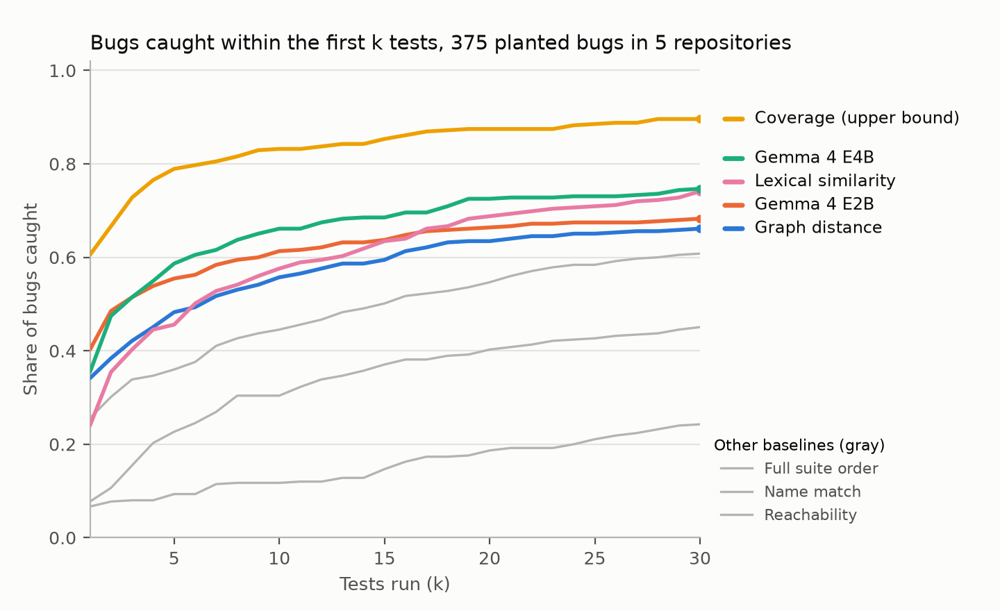
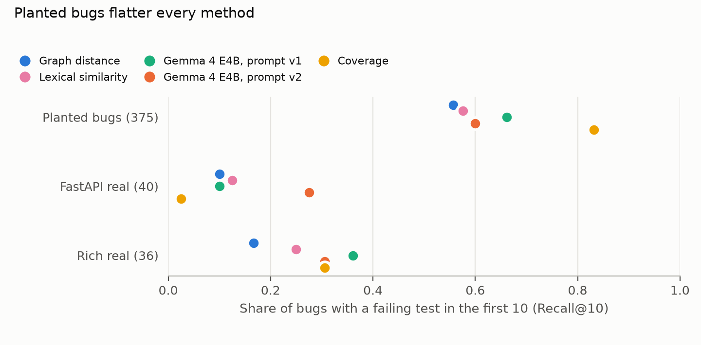
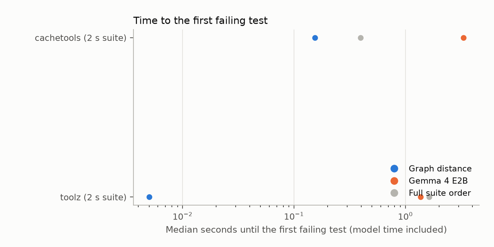

## Key findings

**Takeaway:** order tests by code-graph distance, add a small local model in parallel, and judge the result on real regressions, because planted bugs make every method look better than it is.

We measure Recall@10, the share of bugs whose failing test is among the first 10 tests run. *Planted* bugs are one-operator edits we injected; *real* regressions undo genuine fixes from the competition's own tasks.

- **On planted bugs, a small local model helps.** Graph distance puts a failing test in the first 10 for 56% of 375 bugs; Gemma 4 E4B re-ranking raises that to 66% (+10.4 points, 95% interval +6.7 to +14.1), mostly by finding tests the graph cannot reach, such as tests that call dunder methods through Python syntax.
- **Planted bugs flatter every method.** On 76 real regressions from the competition's FastAPI and Rich tasks, the best method reaches at most 42%. Our pre-registered prompt helps on Rich but not FastAPI; a second prompt that also shows the model tests sharing words with the change fixes FastAPI but did not pass its held-out test on Rich.
- **The competition's provided graph links few tests to code.** Only 285 of its 2,752 call edges run from tests into FastAPI code, and it reaches fewer failing tests than a plain AST graph.
- **The model's latency can cost nothing.** Started in parallel with graph-distance tests, it never slowed the loop on average in our data.

## Abstract

A coding agent on a laptop checks its edits by running tests, and full runs are slow. We study regression test selection for this setting: after a change, order the tests so a failing one comes early. We plant 375 single-operator bugs in five Python repositories, including the competition's FastAPI snapshot, and replay 76 real regressions by undoing real fixes from the competition's FastAPI and Rich tasks. We compare six non-model methods, the competition's provided graph and embeddings, and Gemma 4 E2B and E4B re-ranking. The models help clearly on planted bugs and unevenly on real ones: the pre-registered prompt adds nothing on FastAPI but E4B gains 19 points on held-out Rich, and a second prompt designed on FastAPI did not pass its pre-registered held-out test. We release the benchmark, a drop-in skill for the competition's agent harness, and a notebook that rebuilds every number from cached model answers.

## 1. Introduction

Coding agents fix bugs in a loop: read, edit, run tests, repeat. This competition asks how far that loop can go with Gemma 4 on one accelerator under a time budget, and every full test run spends budget. Developers have the same problem on their own machines.

Regression test selection asks which tests to run first after a change. Classic tools use static dependencies or recorded coverage; agent scaffolds ask a large hosted model. We ask whether a small local model, given a code graph like the one the competition gives its agents, helps, and when its latency is worth paying.

Contributions:
1. The first study, to our knowledge, of code graphs and small local models for test selection, scored directly against kill matrices (which tests fail for each bug).
2. A replay benchmark: 76 real regressions built from the competition's own tasks, plus 375 planted bugs, released with the code that rebuilds them.
3. Evidence that planted bugs overstate test selection, a schedule under which the model's latency costs nothing, and a ready-to-use skill for the competition's harness.

## 2. Data

**Planted bugs.** Four small libraries (cachetools, toolz, humanize, sortedcontainers) and FastAPI at the competition's snapshot for task `fastapi_15800`, so the provided graph and embeddings match the code. In each, we swap one operator (comparison, arithmetic, `and`/`or`, boolean or 0/1 constant) at a uniformly sampled site, run the full suite, and keep the bug only if a test that passes on the original now fails: 80 per library, 60 for FastAPI, 375 after dropping five whose failing tests were missing from the profiling run. Suites take 2 to 31 seconds on one core.

**Real regressions.** For each competition task whose fix edits an existing function, we check out the base commit with its own dependencies, apply the fix and its tests, then undo the fix. Tests that pass with the fix and fail without it are the ground truth. 40 FastAPI and 36 Rich tasks qualified (median 1 to 2 failing tests); tasks adding new code, timing out, or failing with the fix applied were dropped.

**Profiles.** One clean run per repository state records each test's runtime and, with coverage.py's per-test contexts, the lines it executed.

## 3. Methods

Every method returns a full ordering; a partial ranking is completed in default order.

- **Full suite**: pytest's default order.
- **Name match**: tests whose name or file contains the changed function's or module's name.
- **Reachability** and **graph distance**: tests that reach the changed function in a static call graph, the second ordered by shortest-path length.
- **Lexical similarity**: TF-IDF cosine between the changed function's source and each test's source.
- **Coverage**: tests that executed the changed line (on real regressions, the changed function). It needs a recorded run of every test. On planted bugs it is an upper bound; on real regressions it is not, because the failing tests are usually new tests written with the fix, which cover the function no more than hundreds of older tests do.
- **Provided graph and embeddings** (FastAPI): graph distance over the competition's call graph, and cosine of its 256-dimensional node embeddings.
- **Gemma re-rank**: Gemma 4 E2B or E4B (4-bit QAT, Ollama, temperature 0) sees the diff, the function's source, its callers and callees, and candidate tests, and returns up to 15 entries. **Prompt v1** (pre-registered) gives the 30 nearest tests by graph distance plus up to 600 other test names. **Prompt v2** (written after the FastAPI real results) gives 15 graph and 15 lexical candidates plus the full list of test files. The model's list goes first, then graph distance.

**Code graph.** Built from Python ASTs with `contains`, `calls` and `imports` edges, the node and edge types of the competition's graphs; calls are resolved by name.

**Metrics** (fixed in the plan). Recall@k: the share of bugs with a failing test in the first k (k = 1, 10, and 10% of the suite). Time to first failure: test runtime up to the first failing test, plus model time. 95% bootstrap intervals, stratified by repository, 10,000 resamples.

## 4. Results

### 4.1 Planted bugs

**Table 1.** Share of planted bugs with a failing test among the first k tests (n = 375).

| Method | k = 1 | k = 10 | 10% of suite |
|---|---|---|---|
| Full suite order | 0.07 [0.04, 0.09] | 0.12 [0.09, 0.15] | 0.32 [0.28, 0.37] |
| Name match | 0.08 [0.05, 0.10] | 0.30 [0.26, 0.35] | 0.53 [0.48, 0.58] |
| Reachability | 0.26 [0.22, 0.30] | 0.45 [0.40, 0.49] | 0.69 [0.64, 0.73] |
| Graph distance | 0.34 [0.29, 0.39] | 0.56 [0.51, 0.61] | 0.72 [0.68, 0.76] |
| Lexical similarity | 0.24 [0.20, 0.28] | 0.58 [0.53, 0.62] | 0.82 [0.78, 0.86] |
| Gemma 4 E2B re-rank | 0.40 [0.35, 0.45] | 0.61 [0.57, 0.66] | 0.75 [0.70, 0.79] |
| Gemma 4 E4B re-rank | 0.35 [0.31, 0.40] | 0.66 [0.62, 0.71] | 0.80 [0.77, 0.84] |
| Coverage (upper bound) | 0.61 [0.56, 0.65] | 0.83 [0.79, 0.87] | 0.93 [0.91, 0.95] |

**Figure 1.** Share of planted bugs caught within the first k tests.

The pre-registered comparison is the paired difference in Recall@10 against graph distance: E2B +5.6 points [+3.2, +8.3], E4B +10.4 [+6.7, +14.1]. Against lexical similarity (added after seeing it was strong), E4B gains 8.5 points [+2.9, +13.9] and E2B is not distinguishable from zero.

**Table 2.** Recall@10 by repository. "Misses": bugs with no failing test reachable in our static graph.

| Repository | Bugs | Suite (s) | Misses | Graph dist. | Lexical | E2B | E4B | Coverage |
|---|---|---|---|---|---|---|---|---|
| cachetools | 79 | 1.9 | 48 | 0.42 | 0.54 | 0.53 | 0.62 | 0.78 |
| toolz | 78 | 2.0 | 24 | 0.67 | 0.76 | 0.74 | 0.81 | 0.96 |
| humanize | 80 | 1.9 | 0 | 0.69 | 0.39 | 0.71 | 0.68 | 0.88 |
| sortedcontainers | 78 | 23.5 | 16 | 0.62 | 0.83 | 0.65 | 0.77 | 0.91 |
| FastAPI (snapshot) | 60 | 31.3 | 29 | 0.35 | 0.30 | 0.37 | 0.37 | 0.57 |

The gain is largest where the static graph is blind. In cachetools, 48 of 79 bugs had no failing test reachable in the graph, largely because behaviour sits in dunder methods (`__contains__`, `__iter__`) that tests call through syntax, not by name; there E4B lifts Recall@10 from 0.42 to 0.62. For a bug in `TTLCache.__iter__`, graph distance puts the first failing test at position 412 and E4B puts `test_ttl_iter_expired` second. Across the 117 bugs the graph cannot reach, E4B proposed a failing test from outside its reach for 40. Proposals cost precision: for 135 of the 181 bugs where E4B proposed outside tests, none of them failed, and it named 174 tests that do not exist.

On the FastAPI snapshot, the competition's provided graph reached a failing test less often than our AST graph (Recall@10 0.22 [0.12, 0.32] against 0.35 [0.23, 0.47]), and its embeddings did about as well as lexical similarity (0.32 against 0.30). Only 285 of its 2,752 call edges run from tests into FastAPI code. Adding test-to-code edges, for example by resolving calls made through the `TestClient`, would make the provided graph far more useful for this task.

### 4.2 Real regressions

**Figure 3.** Recall@10 on planted bugs and on real regressions. Dots are offset vertically so none hide.

**Table 3.** Real regressions (fix undone): Recall@10, and median rank of the first failing test.

| Method | FastAPI (40) | rank | Rich (36) | rank |
|---|---|---|---|---|
| Graph distance | 0.10 [0.03, 0.20] | 422 | 0.17 [0.06, 0.31] | 346 |
| Lexical similarity | 0.12 [0.03, 0.23] | 217 | 0.25 [0.11, 0.39] | 34 |
| Coverage | 0.03 [0.00, 0.07] | 566 | 0.31 [0.17, 0.47] | 21 |
| E2B, prompt v1 | 0.10 [0.03, 0.20] | 422 | 0.25 [0.11, 0.39] | 313 |
| E4B, prompt v1 | 0.10 [0.03, 0.20] | 422 | 0.36 [0.19, 0.53] | 189 |
| E2B, prompt v2 | 0.25 [0.12, 0.40] | 189 | 0.42 [0.25, 0.58] | 27 |
| E4B, prompt v2 | 0.28 [0.15, 0.42] | 199 | 0.31 [0.17, 0.47] | 21 |

Every method does far worse than on planted bugs (Figure 3). The failing tests are usually the ones written with the fix, and the changed functions are run by hundreds of other tests, so even coverage ranks them late on FastAPI.

With the pre-registered prompt, the models add nothing on FastAPI: only 4 of 40 tasks had a failing test among the 30 graph candidates, and the new tests were rarely in the 600 other names. On Rich, built afterwards and never tuned on, E4B with prompt v1 beats graph distance by 19.4 points [+8.3, +33.3].

Prompt v2 fixes the FastAPI blind spot (E4B 0.28, post hoc). We froze its held-out test before running it anywhere else, and in plain words it failed: a prompt tuned on one repository did not reliably transfer to another (Rich, E4B v2 minus graph distance +13.9 points, interval [0.0, +27.8]). E2B with v2 did transfer (+25.0 [+11.1, +38.9]), and on planted bugs v2 helps E2B (0.61 to 0.66) but hurts E4B (0.66 to 0.60).

### 4.3 What it costs an agent

Median model time per change was 2.5 s for E2B and 13.9 s for E4B. Graph distance usually reaches a failing planted bug within a fraction of a second, so run first, the model loses on time (Figure 2).

**Figure 2.** Median seconds until the first failing test, model time included for Gemma rows (log scale).

The latency need not be paid in sequence. In a **hybrid schedule** tests start at once in graph-distance order while the model thinks, then switch to the model's order, skipping tests already run. It was never slower on average on our suites (pooled 1.47 s against 1.49 s), and with test runtimes scaled by 10, 100 and 300 the E4B hybrid reached the first failure 9%, 11% and 14% sooner than graph distance. On the real regressions, whose suites take a median 12 to 14 s per run, E4B with prompt v2 reached the first failing test after a median 0.6 s (FastAPI) and 0.3 s (Rich) of test time, against 1.6 s and 2.9 s for graph distance. These latency analyses were not in the plan and are guides, not measurements.

### 4.4 A recipe for agents

1. Order tests by call-graph distance from the changed functions; it costs nothing and is a strong baseline.
2. Interleave tests that share identifiers with the changed code; on real regressions this catches tests written for the bug.
3. If a local model is available, start the tests at once and let the model re-rank in parallel (hybrid), so its latency never blocks.
4. Evaluate on replayed real regressions, not only planted bugs.

Steps 1 and 2 ship as `skills/which_tests_first`, an ADK skill in the competition's submission format that reads the agent's own `git diff` and needs no model call.

## 5. Related work

Ekstazi (Gligoric et al., 2015) selects tests from recorded file dependencies and STARTS (Legunsen et al., 2017) from static class dependencies; Google ranks tests over a hybrid call graph at scale (Regression Test Selection at Scale). Our graph-distance and coverage baselines are small versions of these. Agentless (Xia et al., 2024) asks a hosted model which tests relate to an edit; TestPrune (2025) predicts suspicious methods and minimises the suite through coverage. Both use large hosted models and judge selection only through issue resolution; we score it directly, with laptop-sized models. Mutant detection correlates with real-fault detection (Just et al., 2014); Section 4.2 shows the gap can still be large for selection.

## 6. Limitations

- **Small real sets.** 76 real regressions from two repositories give wide intervals; prompt v2 was designed after seeing the FastAPI half.
- **Python only.** The static graph's blind spots are Python's (inheritance, decorators, dynamic attributes).
- **Two small models, one laptop.** Latency comes from an Apple M5 with 16 GB; larger models may do better.
- **Memorisation.** These projects may be in Gemma's training data; the bugs are new, the test names are not.

## 7. Reproducibility

The analysis plan (`analysis_plan.md`, SHA-256 `9410...a9fd`) was committed before any method ran, and the prompt v2 addendum (`c55d...7d09`) before v2 ran on Rich or the planted bugs. The public repository and Kaggle notebook contain the bugs, kill matrices, per-test runtimes, every model prompt and answer cached by hash, and the scripts; the notebook rebuilds every table and figure on CPU without calling a model (about 2.5 minutes on Kaggle). Two pipeline faults were found and fixed, with both runs kept: FastAPI prompts first overflowed a 16k context (rerun at 32k), and test names without their `[parameter]` suffix were first counted as unknown (re-scored from cache).

## References

- Gligoric, M., Eloussi, L., and Marinov, D. (2015). Practical regression test selection with dynamic file dependencies. ISSTA.
- Legunsen, O., Shi, A., and Marinov, D. (2017). STARTS: STAtic regression test selection. ASE (tool demo).
- Just, R., Jalali, D., Inozemtseva, L., Ernst, M. D., Holmes, R., and Fraser, G. (2014). Are mutants a valid substitute for real faults in software testing? FSE.
- Xia, C. S., Deng, Y., Dunn, S., and Zhang, L. (2024). Agentless: Demystifying LLM-based software engineering agents. arXiv:2407.01489.
- When Old Meets New: Evaluating the impact of regression tests on SWE issue resolution (TestPrune) (2025). arXiv:2510.18270.
- Regression Test Selection at Scale. Google Research. https://research.google/pubs/regression-test-selection-at-scale-2/
- Markowitz, E., et al. (2026). Google - The Gemma 4 Developer Agent Competition. Kaggle.

## Links

- Code, data and cached model answers: https://github.com/kinnuworks/which-tests-first
- Notebook that rebuilds every number: https://www.kaggle.com/code/dhirajkavuri/which-tests-should-run-first-rebuild-every-number
